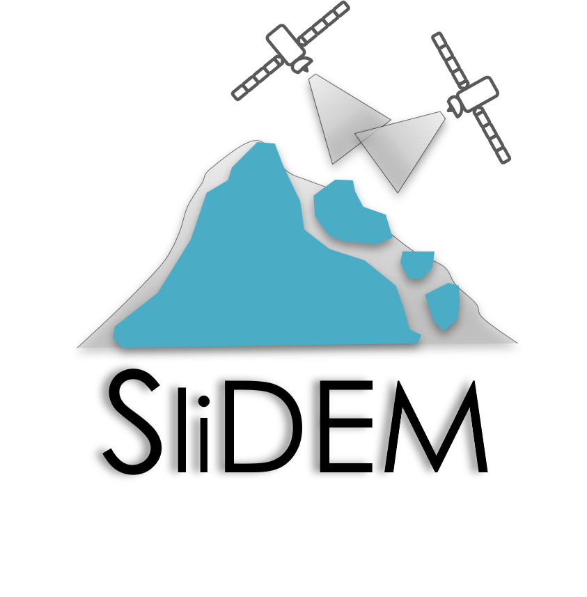

[](https://www.repostatus.org/#wip)
[](https://zenodo.org/doi/10.5281/zenodo.10634421)



# SliDEM
Assessing the suitability of DEMs derived from Sentinel-1 for landslide volume estimation.

## Goal
The overall goal of SliDEM is to assess the potential for determining landslide volumes based on digital elevation models (DEMs) derived from Sentinel-1 SAR data. Therefore, we will develop a low-cost, transferable, semi-automated method implemented within a Python package based on open-source tools. 

Find the project updates on [ResearchGate](https://www.researchgate.net/project/SliDEM-Assessing-the-suitability-of-DEMs-derived-from-Sentinel-1-for-landslide-volume-estimation) and check our [Publications & Conference proceedings](https://github.com/SliDEM-project/SliDEM-python/wiki/Publications-&-Conferences) for more details.

---

**NOTES!** 

Even if we call it the SliDEM package, the structure of a package is not there yet. 
We are currently developing this repository actively and hope to have a working package soon. 

**We have implemented a [changelog](CHANGELOG.md)**, please check it frequently for updates, including new ways to call 
the scripts or changes in parameters. 

Currently, we present a series of executable scripts to run within a Docker container. 
You will see the instructions on how to set it up and start running the scripts below. 

---
## Setup

To run the scripts inside a docker container, follow these steps:

1. Install Docker if you do not have it already
    - See instructions for [Windows here](https://docs.docker.com/desktop/windows/install/) and for [Linux here](https://docs.docker.com/engine/install/).

2. Create a container to work on
    - Go to you terminal and type the command below.
    - You can mount a volume into the container.
    - We recommend having a `data` folder where all the data can be included and through the volume, it can also be accessed inside docker. 
    - What the command does:
      - `docker run` is the command to run an image through a container
      - `-it` calls an interactive process (like a shell)
      - `--entrypoint /bin/bash` will start your container in bash
      - `--name snap` gives a name to your image, so you can refer to it later
      - `-v PATH_TO_DIR/SliDEM-python:/home/` mounts a volume on your container. 
Replace `PATH_TO_DIR` with the path of the directory you wish to mount
      - `--pull=always` will update the Docker image to the latest available on Docker Hub 
      - `loreabad6/slidem` is the Docker image available on DockerHub for this project

   ```
   docker run -it --entrypoint /bin/bash --name snap -v PATH_TO_DIR/SliDEM-python:/home/ --pull=always loreabad6/slidem
   ```

3. You can remove the container once you are done. All results should be written to the mounted volume, but of course make sure that this is well set in the parameters when calling the scripts. 
   - You can exit your container by doing `CTRL+D`
   - you can delete the container with:
   ```
   docker stop snap
   docker rm snap
   ```
   - If you don't want to delete your container after use, then just **exit** it, **stop** it, and next time you want to use it run:
   ```
   docker start snap
   docker exec -it snap /bin/bash
   ```

4. Using `xdem`:
   - Given the different dependencies for this module, you should use the virtual environment created for it.

   ```commandline
   # to activate:
   conda activate xdem-dev
   
   # to deactivate:
   conda deactivate
   ```
   - Please test that the configuration when building the docker container 
was correct with (this might take several minutes):
   
   ```commandline
   cd xdem
   pytest -rA
   ```

## Workflow

So far, steps are organized into 4 executable scripts:
1. Query S1 data
2. Download S1 data
3. Compute DEM from S1 data
4. Calculate DEM accuracy

The scripts are included within the Docker image, and therefore are inside the 
container you created in the folder `scripts`. 
To run them, you can follow the examples below. 
Please notice that some scripts require you to call `python3.6` 
or alternatively activate a conda environment and then 
call only `python`.

We recommend you mainly work on the `data` directory as download folder and a workplace to save your results. 
But of course this is up to you.

### 1. Query 
For this script, since we are using ASF to query images, no credentials are needed. 
Depending on your selected time range, the data querying can take long since what it does is loop over every single image that
intersects your AOI and find matching scenes for the whole S1 lifetime 
(I know a bit useless but seems to be the only way now).

```commandline
# Usage example
python3.6 scripts/0_query_s1.py --download_dir data/s1/ --query_result s1_scenes.csv --date_start 2019/06/01 --date_end 2019/06/10 --aoi_path data/aoi/alta.geojson
```
```commandline
# Get help
python3.6 scripts/0_query_s1.py -h
```

### 2. Download
Once you have run the query script, you will have a CSV file as an output. 
This file contains all the SAR image pairs that intersect your AOI and time frame and 
that correspond to the perpendicular and temporal thresholds set. 

We ask you now to go through the CSV file, and check which image pairs you would like to Download. 
For this you need to change the cell value of the image pair row under the column `Download` from `FALSE` to `TRUE`. 

Why is this a manual step? Because we want the analyst to check if the image pair is suitable or not for analysis. 
To help we added a link to the Sentinel Hub viewer for th closest Sentinel-2 image available for the dates of the image pair. 
Here you will be able to check if there was snow during your time period, if the cloud coverage was dense, if your area has
very dense vegetation that might result in errors, etc. 

**IMPORTANT!**
Since the download step is done through the ASF server, we need credentials that allow you to obtain the data. 
The credentials should be saved in a file called [`.env`](.env) on the directory mounted as a volume on the docker.
Username should be saved as `asf_login` and password as `asf_pwd`. See an example below:

```text
asf_login='USERNAME'
asf_pwd='PASSWORD'
```

If you cloned this repo, you will see an example of such a file on the main directory.
Here you can replace `USERNAME` and `PASSWORD` with your credentials.

Once the changes to the CSV files are saved and your `.env` file is ready, you can run the `1_download_s1.py` script as shown below.

```commandline
# Usage example
python3.6 scripts/1_download_s1.py --download_dir data/s1/ --query_result s1_scenes.csv
```
```commandline
# Get help
python3.6 scripts/1_download_s1.py -h
```

Downloading Sentinel-1 data always takes a while and requires a lot of disk space. 
Remember that the download occurs on your local disk, if you have mounted a volume as suggested. 
Be prepared and patient! :massage:

### 3. DEM generation
Now it is finally time to generate some DEMs. 
Taking the downloaded data and the query result form previous steps, we can now call the `2_dem_generation.py` module. 

The main arguments passed into this module are the path to the downloaded data, 
the CSV file which will be used to get the image pairs, a directory where the results are stored
and the AOI to subset the area and to automatically extract bursts and subswaths. 

Several other parameters can be passed to specific parts of the workflow. 
Check the help for their descriptions and default values.
```commandline
# Usage example
python3.6 scripts/2_dem_generation.py --download_dir data/s1/ --output_dir data/results/ --query_result s1_scenes.csv --pair_index 0 --aoi_path data/aoi.geojson
```
```commandline
# Get help
python3.6 scripts/2_dem_generation.py -h
```

If you skipped the query and download steps, you can pass your own index pairs as a list to the dem generation script:
```commandline
# Usage example
python3.6 scripts/2_dem_generation.py --download_dir data/s1/ --output_dir data/results/ --pair_ids 's1_scene_id_1' 's1_scene_id_2' --aoi_path data/aoi.geojson
```

#### Generating DEMs in a loop
If you are looking into generating DEMs in a loop, you can create a shell file (`.sh` extension) with the following:

```shell
# replace {0..1} with the number of image pairs you 
# have set on your queried file (CSV). So for example, if you
# set Download = TRUE for 5 pairs then do {0..4}
for i in {0..1}; do
  python3.6 scripts/2_dem_generation.py --download_dir data/s1/ --output_dir data/results/ --query_result s1_scenes.csv --pair_index "$i" --aoi_path data/aoi.geojson
done
```

Depending on whether you have been using the container before, the processing might take more or less time.
The main reason is that reference DEM data is being downloaded for the data. 

### 4. Accuracy assessment
I strongly recommend you do your own accuracy assessment of the resulting products with 
[xDEM](https://xdem.readthedocs.io/en/latest/). 

However, I have included a module that will allow 
the generation of several plots and error measurements based on `xDEM` that can help you get an idea
of the quality of the DEMs. 

Please bear in mind I am still implementing this so the script and outputs might change a lot. 
**ALSO** make sure you activate the conda environment for `xDEM` before running the script. 

```commandline
# Usage example
conda activate xdem-dev
python scripts/3_assess_accuracy.py -h
```

For now the arguments include several paths to data folders, see the help with the command above. 

**Note:** For the following paths:
- reference DEM you want to use
- (optional) LULC data to calculate statistics over land cover classes

You can use the script below to get reference DEM data from OpenTopography and LULC data from WorldCover.
Please consider you will need to create an account and get an API key for OpenTopography (all free).
```commandline
# Usage example
conda activate xdem-dev
python scripts/3_1_aux_data_download.py -h
```

When using the accuracy assessment script, add the flag `--coregister` 
to perform coregistration with the given reference DEM. This will default to 
Nuth-Kääb and De-ramping with degree 1 coregistration approaches, 
but you can pass more methods with the `--coregistration-method` flag. 

#### Running the accuracy assessment in a loop
Like generating DEMs in a loop, you can run the 3_accuracy_assessment script over a
directory where DEM outputs from different time-steps are stored. 
Specially if there were no changes in the directory structure, this could be a helpful
bash script to run the accuracy assessment in a loop:

```shell
for file in $(find home/data/results -maxdepth 1 -name "out_*" -type d | cut -d'/' -f2-); do
  python -W ignore scripts/3_assess_accuracy.py --s1_dem_dir ${file} --unstable_area_path data/aoi/unstable_area.gpkg --ref_dem_path data/reference_dem.tif --ref_dem_name NASADEM --elev_diff_min_max 100 --lulc_path data/lulc.tif --coregister
done
```

In this script you should replace `home/data/results` with the parent directory 
where the directories starting with `out_*` are located. 
`maxdepth` means it will only go one level in the directory tree,
the `cut` statement removes the `home/` part of the find results to avoid conflicts
on how the data is called. 

When calling the python script, the `-W ignore` flag is added to skip user warnings 
related to nodata.
`--s1_dem_dir` is the parameter that will get looped over. 
All the other arguments should be replaced with paths to the relevant data sources.


### 5. Volume calculation
The final task of the `slidem` script sequence is volume calculation.
In the script you can add a pre-event and a post-event DEM, from which to 
calculate the volume of a specific "unstable area" outline. 

You can also pass a reference DEM, which will be used to calculate the error
associated with each input S1-DEM, and consequently will serve to compute
the propagation error for the estimated volume. 
Currently, the NMAD and Standard Error (SDE) are used for this task.

The script will compute a DoD, produce a figure with a histogram of 
elevation difference values and another with maps of the 
pre- and post-event DEM and its DoD for comparison. 

A CSV file called volume_estimates.csv will also be created. 
This file will be updated everytime the same output directory is used, 
regardless of the pre- and post-event DEM data paths passed. The CSV file 
will collect the file name of each of these, and is meant ot ease comparison
between several runs of the script. 

Make sure you activate the conda environment for `xDEM` before running 
the script. 

```commandline
# Usage example
conda activate xdem-dev
python scripts/4_calculate_volume.py -h
```

## Issues/problems/bugs

We try to document all bugs or workflow problems in our 
[issue tracker](https://github.com/SliDEM-project/SliDEM-python/issues).

Also feel free to browse through 
[our wiki](https://github.com/SliDEM-project/SliDEM-python/wiki/) 
with some FAQ.

We are working to improve all these issues but 
for the moment please be aware and patient with us :pray: 

Feel free to open an issue if you find some new bug or have any request!

Please refer to our [contributing guide](https://github.com/SliDEM-project/SliDEM-python/blob/main/CONTRIBUTING.md) for further info.


## Acknowledgements

 This work is supported by the Austrian Research Promotion Agency (FFG)
through the project [SliDEM](https://projekte.ffg.at/projekt/4052533) (Assessing the suitability of DEMs derived
from Sentinel-1 for landslide volume estimation; contract no. 885370).

## Copyright
Copyright 2022 Department of Geoinformatics – Z_GIS, University of Salzburg

Licensed under the Apache License, Version 2.0 (the "License");
you may not use this file except in compliance with the License.
You may obtain a copy of the License at

http://www.apache.org/licenses/LICENSE-2.0

Unless required by applicable law or agreed to in writing, software
distributed under the License is distributed on an "AS IS" BASIS,
WITHOUT WARRANTIES OR CONDITIONS OF ANY KIND, either express or implied.
See the License for the specific language governing permissions and
limitations under the License.
